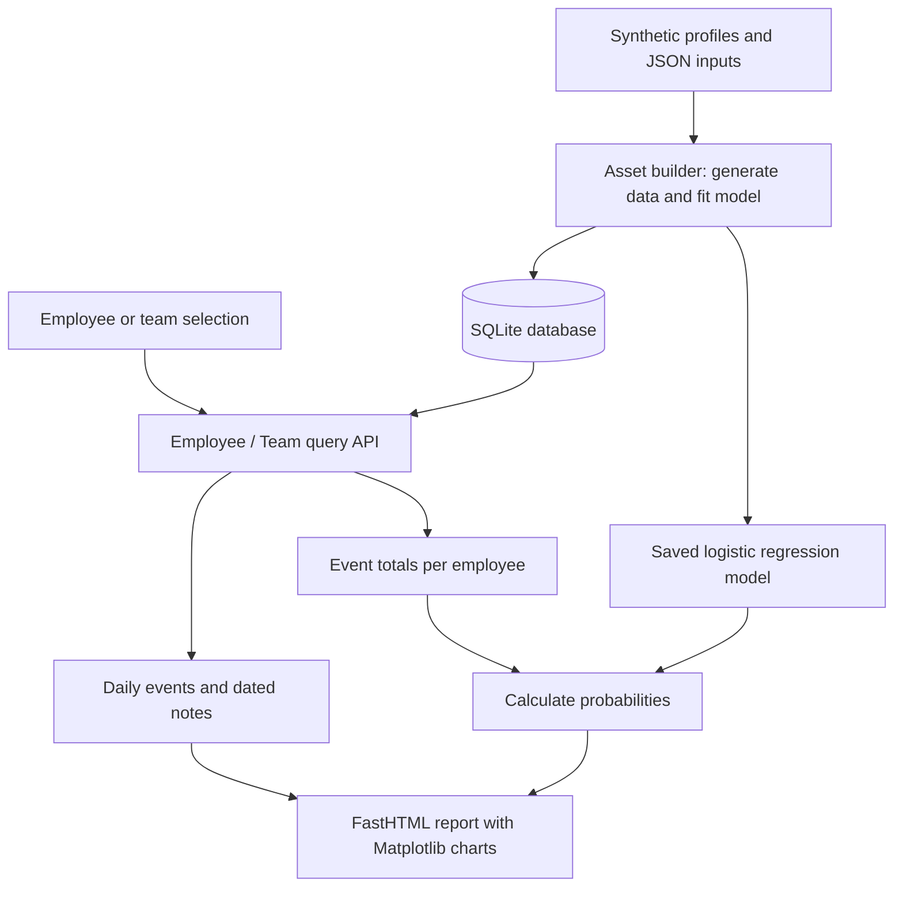

# Employee Events and ML Dashboard

This project shows how to turn event records into a Python dashboard: store data in SQLite, retrieve it through a reusable package, calculate model predictions, and present charts and notes in a web interface.

It uses **synthetic employee data** and was developed from Udacity's Software Engineering for Data Scientists material. Its main value is demonstrating how data access, machine learning, and presentation fit together. The displayed recruitment score is an illustrative model output, with no established accuracy for real employment decisions.

**Current status:** the bundled database and direct imports from the data-access modules can be used locally. Dashboard startup is blocked by a package import issue described under [Local setup and current startup status](#local-setup-and-current-startup-status). The screenshot below is an existing preview, not evidence that the current checkout starts successfully.

## What the dashboard shows

The interface lets a user choose **Employee** or **Team**, select an entry from a dropdown, and submit the selection. The resulting report contains:

- **Cumulative event counts:** running totals of positive and negative events over the stored history. A team view combines its members' events.
- **Predicted Recruitment Risk:** a model-generated probability for one employee, or the average of individual probabilities for a team.
- **Dated notes:** descriptive text associated with the selected employee or team. Notes provide context but are not inputs to the model.

The implemented controls select an entity type and an entity. There are no date-range, shift, or manager filters, and no side-by-side team comparison. Shift and manager information exists in the database but is not exposed as a dashboard filter.


## Architecture

The project separates three responsibilities: preparing data and fitting the model, querying stored records, and rendering the report. This allows the query package to be used independently of the web interface.



The diagram describes the implemented responsibilities and intended request flow; the current startup blocker prevents a complete browser demonstration.

| Responsibility | Main files | How it works |
| --- | --- | --- |
| Data generation and model fitting | [src/build_project_assets.py](src/build_project_assets.py), [src/generated_data/](src/generated_data/) | Combines simulated events with JSON names, notes, and team metadata; writes the database and fitted model. |
| Database execution | [sql_execution.py](python-package/employee_events/sql_execution.py) | `QueryMixin` opens SQLite connections, returns rows or pandas DataFrames, and closes connections after each call. |
| Entity queries | [query_base.py](python-package/employee_events/query_base.py), [employee.py](python-package/employee_events/employee.py), [team.py](python-package/employee_events/team.py) | `QueryBase` shares event and note queries. `Employee` and `Team` supply names and model features for their respective scopes. |
| Reusable UI components | [report/base_components/](report/base_components/), [report/combined_components/](report/combined_components/) | Small renderers build controls, tables, and charts; combined components assemble them into forms and page sections. |
| Report and request handling | [report/dashboard.py](report/dashboard.py) | Routes pass the selected ID and an `Employee` or `Team` object to the same report layout. |
| Model loading | [report/utils.py](report/utils.py), [assets/model.pkl](assets/model.pkl) | Loads the fitted classifier when `BarChart` is defined and reuses it for subsequent renders. |
| Package installation | [python-package/setup.py](python-package/setup.py), [package requirements](python-package/employee_events/requirements.txt) | Packages the query modules and database for use outside the dashboard. |

In the component methods, the argument named `model` is the **data-access object** (`Employee` or `Team`). The machine-learning estimator is named `predictor`. This distinction explains how the same UI can work with either entity type.

FastHTML builds the page in Python. HTMX, a browser library used by the form controls, requests a replacement dropdown when the entity type changes. Matplotlib renders charts into images embedded in the HTML. The app calls `fast_app()` with its default styling setup; the repository's `assets/report.css` has no explicit reference in the dashboard code.

## Data flow

### Preparing the artifacts

The asset builder generates weekday event records, assigns employees to teams, and attaches names and notes from the JSON files. It then:

1. Creates the employee, team, event, and note tables.
2. Sums positive and negative event counts for each employee.
3. Fits logistic regression using those two totals and a simulated binary `recruited` label.
4. Saves the classifier to `assets/model.pkl` and the tables to `python-package/employee_events/employee_events.db`.

Training is separate from dashboard requests. Opening a report uses the existing artifacts; it does not retrain the model or fetch new data.

### Rendering a selection

Submitting the form sends the entity type and ID to `/update_data`, which redirects to `/employee/{id}` or `/team/{id}`. The root route selects employee 1 by default.

The report calls the selected entity's query methods. Daily event totals are sorted by date and converted to cumulative sums for the line chart. Model features go to the saved classifier's `predict_proba` method, which returns class probabilities. The notes query supplies the table. `CombinedComponent` assembles the header, filters, charts, and notes into one report.

A common query interface makes the scope change explicit: `event_counts()` returns totals by date, `notes()` returns dated text, and `model_data()` supplies the numeric features needed for prediction.

## Data and score interpretation

The **bundled database snapshot** contains the following records. These counts and dates describe the checked-in artifact; regeneration can change them.

| Table | Rows | Contents |
| --- | ---: | --- |
| `employee` | 25 | Employee IDs, names, and team assignments. |
| `team` | 5 | Team IDs, names, shifts, and managers. |
| `employee_events` | 6,525 | Dated positive and negative event counts, covering 2023-10-23 through 2024-10-21. |
| `notes` | 125 | Dated text linked to employee and team IDs. |

Employee and team IDs connect these tables in the query logic. The SQLite tables do **not** declare primary-key or foreign-key constraints, and each includes an `index` column exported by pandas. The existing [schema image](img.png) is a conceptual illustration; its key annotations do not describe enforced database constraints.

The classifier is `LogisticRegression(penalty=None)`, trained without regularization on two features: total `positive_events` and total `negative_events`. Although there are thousands of event rows, aggregation produces **only 25 employee-level training examples**.

The target `recruited` is sampled once per employee using a probability associated with a simulated profile. It is not an observed future recruitment outcome, and the project defines no prediction horizon such as “within the next 90 days.” The training script fits all available employee examples without a held-out evaluation.

| View | Features passed to the classifier | Displayed value |
| --- | --- | --- |
| Employee | One row containing that employee's two event totals. | Probability assigned to `recruited = 1`. |
| Team | One feature row per member with recorded events. | Unweighted mean of those individual probabilities. |

The team score is not a separately trained team prediction or the probability that at least one member will be recruited. For example, member probabilities of 10% and 30% produce a displayed team score of 20%.

Employee queries return columns named `Positive` and `Negative`; the dashboard renames them to the training feature names. Team queries already use those names. Both supply positive totals first and negative totals second. Notes, names, shifts, and managers are not model features.

The bar is green below 10%, orange from 10% to below 30%, and red at 30% or above. These are fixed display rules, not thresholds justified by model evaluation or business costs.

## Local setup and current startup status

Python 3.12 is the environment used for local checks. The GitHub Actions configuration lists Python 3.12 and 3.10.10; that configuration alone does not establish that the dashboard works on either version.

From the repository root, create an environment and install the project dependencies. For macOS/Linux with Python 3.12 available:

```bash
python3.12 -m venv .venv
source .venv/bin/activate
python -m pip install -r requirements.txt
```

On Windows, create the environment with `py -3.12 -m venv .venv` and activate it in PowerShell with `.\.venv\Scripts\Activate.ps1` before installing dependencies.

The root requirements include an editable installation of `./python-package`, so changes to that source package are visible to the environment. Core libraries are pinned, including scikit-learn 1.5.2, pandas 2.2.3, and python-fasthtml 0.8.0; some development tools and transitive dependencies remain unpinned.

### Explore the data package

The query classes can be imported directly from their modules without starting the dashboard:

```python
from employee_events.employee import Employee
from employee_events.team import Team

employee = Employee()
print(employee.event_counts(1).head())  # Daily positive and negative totals.
print(employee.notes(1).head())         # Dated text for employee 1.
print(Team().model_data(1))              # One feature row per member of team 1.
```

### Dashboard startup blocker

The script entry point is:

```bash
python report/dashboard.py
```

**This command currently fails during import.** The dashboard requests `QueryBase`, `Employee`, and `Team` from the package root, but their exports are commented out in [employee_events/__init__.py](python-package/employee_events/__init__.py). The missing exports must be resolved before startup can proceed. Successful startup and browser interactions still need verification after that correction.

`python -m report.dashboard` is also not a supported alternative with the current import layout: the dashboard uses sibling imports such as `from utils import load_model` rather than package-qualified imports. For a presentation of the current checkout, use the existing screenshot and a source walkthrough.

### Regenerating data and the model

Regeneration is optional and is not needed to explore the bundled database. The generator expects `src/` as its working directory. **It overwrites the database tables and model artifact**, uses the current date, and has no fixed random seed. Preserve the bundled artifacts if you need to keep the displayed results consistent.

To deliberately generate a new dataset and model from an activated environment:

```bash
cd src
python build_project_assets.py
```

Despite their directory name, the files in `src/generated_data/` are required JSON inputs to this script. The training labels are not retained in the saved database, so the database alone is insufficient to reconstruct the original training evaluation.

## Tests and automation

From the repository root in the activated environment:

```bash
python -m pytest -q
```

The four tests in [tests/test_employee_events.py](tests/test_employee_events.py) check that the database file exists and that it contains the `employee`, `team`, and `employee_events` tables. These are **smoke checks**: they establish that basic artifacts are present, not that queries, predictions, or browser interactions are correct. They do not check the `notes` table, data quality, or model performance.

The [test workflow](.github/workflows/test.yml) builds a source distribution, installs dependencies, and runs pytest. The [lint workflow](.github/workflows/lint.yml) invokes Flake8. The Python files currently contain file-level `# flake8: noqa` directives, so a passing lint job would not demonstrate comprehensive lint enforcement.

## Limitations and known assumptions

| Area | Current limitation | Known assumption or interpretation |
| --- | --- | --- |
| Predictive validity | Only 25 synthetic training examples; no holdout, baseline comparison, calibration check, or uncertainty estimate. Calibration means checking whether predicted probabilities match observed frequencies. | Scores refer to the simulated `recruited` label. They have no validated interpretation as real-world recruitment risk or a prediction over a defined future period. |
| Data quality | The stored snapshot includes negative numeric values in both event-count columns. Counts and relationships are not validated or constrained by the database schema. | Queries rely on consistent employee and team IDs and use stored counts as provided, including negative values. |
| Reproducibility | Randomness and the current date affect generation; artifacts have no accompanying training run record, saved labels, or evaluation report. | The bundled database and model define the demonstration snapshot. Regeneration is not expected to reproduce the same records or predictions. |
| Application behavior | Startup is blocked; tests do not cover imports, routes, form changes, empty results, or invalid IDs. | The intended rendering flow assumes a valid employee or team selection with usable records. Passing the smoke tests does not establish that the dashboard works. |
| Query safety | IDs are inserted into SQL strings. Detail routes convert IDs to integers, but direct package callers do not receive that protection. | The query layer assumes trusted numeric IDs from its callers and table names supplied by the internal entity classes. |
| Deployment and operations | No application authentication or authorization, model monitoring, or retraining workflow is implemented. Rendering reuses component instances and Matplotlib state. | The implementation is a local demonstration. Concurrent request handling and suitability for production use have not been established. |
